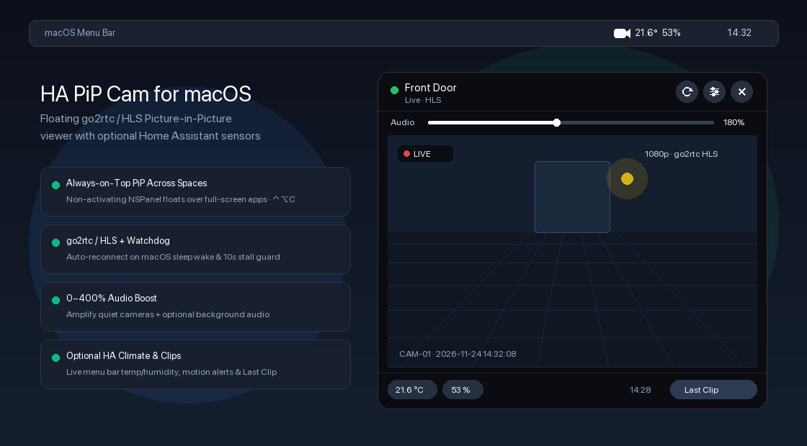

# HA PiP Cam

[](https://github.com/alexandryasukaitisss-cmd/ha-pip-cam-macos/actions/workflows/ci.yml)
[](https://github.com/alexandryasukaitisss-cmd/ha-pip-cam-macos/releases)
[](https://github.com/alexandryasukaitisss-cmd/ha-pip-cam-macos)
[](LICENSE)

[Русский](README.ru.md) · [Releases](https://github.com/alexandryasukaitisss-cmd/ha-pip-cam-macos/releases) · [MIT](LICENSE)

**A native macOS menu bar floating Picture-in-Picture (PiP) live camera viewer for `go2rtc` / HLS streams — with optional Home Assistant motion alerts, last-clip playback, and live room climate in your menu bar.**



Keep an eye on a front door, nursery, 3D printer, pet cam, or workshop stream while working in any macOS Space or full-screen app — without keeping a heavy browser tab open.

## Features

- **Always-on-top non-activating PiP panel** — floats cleanly over full-screen apps and joins all macOS Spaces without stealing focus. Toggle instantly from the menu bar or via global shortcut **`⌃⌥C`**.
- **Works with any `go2rtc` or HLS (`.m3u8`) camera stream** — no Home Assistant required for live video/audio! Includes a built-in stall watchdog, slow-connect diagnostics, and instant wake-from-sleep reconnect.
- **0–400% software audio boost + background audio** — amplify quiet room microphones without touching macOS system volume, and optionally keep audio listening even when the video panel is closed.
- **Optional Home Assistant integration** — display live temperature & humidity right in the macOS menu bar (with automatic offline hiding so stale values are never shown), receive native macOS motion notifications, auto-pop the PiP panel on motion, and open the latest motion clip in one click.
- **Keychain token storage & native Swift 6** — stores your Home Assistant token in macOS Keychain (or optional token file `~/.config/ha-pip-cam/token`), zero Electron, zero telemetry.

## Install

### Homebrew (recommended)

```sh
brew install --cask alexandryasukaitisss-cmd/tap/ha-pip-cam
```

### Direct download

Download `HAPiPCam-0.1.0-macos-arm64.zip` from [GitHub Releases](https://github.com/alexandryasukaitisss-cmd/ha-pip-cam-macos/releases) and move `HAPiPCam.app` into `/Applications`.

> Because the release binary is ad-hoc signed rather than Apple-notarized, macOS Gatekeeper may ask you to allow it via **Right-click → Open** or `xattr -dr com.apple.quarantine /Applications/HAPiPCam.app`.

### Build from source (macOS 14+, Swift 6)

```sh
git clone https://github.com/alexandryasukaitisss-cmd/ha-pip-cam-macos.git
cd ha-pip-cam-macos
chmod +x script/build_and_run.sh
./script/build_and_run.sh --run
```

## Quick Setup

1. Point [go2rtc](https://github.com/AlexxIT/go2rtc) (or Home Assistant / Frigate) at your RTSP/ONVIF camera so it exposes an HLS endpoint such as `http://127.0.0.1:1984/api/stream.m3u8?src=front_door`.
2. Right-click the HA PiP Cam menu bar icon → **Settings…** and paste your HLS Stream URL.
3. *(Optional)* Add your Home Assistant Base URL, Long-Lived Access Token (saved to Keychain), camera entity, and temperature/humidity sensor entities.
4. Press **`⌃⌥C`** or left-click the menu bar icon to toggle the floating PiP window.

You can also pass `--stream <url>` and `--show` on the command line for quick testing.

## Tests

```sh
swift test
```

## License

MIT. See [LICENSE](LICENSE).
