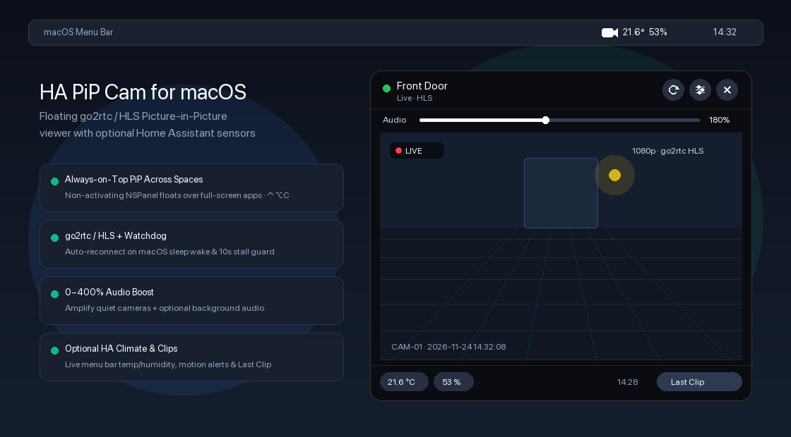

# HA PiP Cam

[](https://github.com/alexandryasukaitisss-cmd/ha-pip-cam-macos/actions/workflows/ci.yml)
[](https://github.com/alexandryasukaitisss-cmd/ha-pip-cam-macos/releases)
[](https://github.com/alexandryasukaitisss-cmd/ha-pip-cam-macos)
[](LICENSE)

[English](README.md) · [Релизы](https://github.com/alexandryasukaitisss-cmd/ha-pip-cam-macos/releases) · [MIT](LICENSE)

**Нативное macOS-приложение в menu bar для плавающего Picture-in-Picture (PiP) окна камеры (`go2rtc` / HLS) — с опциональными датчиками климата, уведомлениями о движении и просмотром последнего клипа из Home Assistant.**



Удобно держать на экране камеру входной двери, детской, 3D-принтера или мастерской поверх любых окон и полноэкранных рабочих столов — без открытой вкладки браузера.

## Возможности

- **Плавающее PiP-окно поверх всех Spaces** — не перехватывает фокус, открывается по клику в строке меню или глобальной горячей клавише **`⌃⌥C`**.
- **Любой поток `go2rtc` или HLS (`.m3u8`)** — работает даже без Home Assistant. Встроен watchdog от зависания потока и авто-переподключение после выхода Mac из сна.
- **Усиление звука до 400% и фоновое аудио** — усиливает тихий микрофон камеры без изменения системной громкости macOS; звук можно оставить включённым при скрытом окне.
- **Опциональная интеграция с Home Assistant** — температура и влажность прямо в строке меню (скрываются при потере связи, чтобы не показывать устаревшие данные), нативные уведомления о движении и кнопка **Last Clip**.
- **Токен в macOS Keychain, чистый Swift 6** — без Electron и телеметрии.

## Установка

### Homebrew (рекомендуется)

```sh
brew install --cask alexandryasukaitisss-cmd/tap/ha-pip-cam
```

### Прямое скачивание

Скачайте `HAPiPCam-0.2.1-macos-arm64.zip` из [GitHub Releases](https://github.com/alexandryasukaitisss-cmd/ha-pip-cam-macos/releases), распакуйте и перенесите `HAPiPCam.app` в `/Applications`.

> [!NOTE]
> **Первый запуск на macOS (без платной нотаризации Apple):** Готовые сборки подписаны ad-hoc, поэтому при первом запуске Gatekeeper покажет предупреждение *«Apple не удалось подтвердить, что файл «HAPiPCam» не содержит вредоносного ПО»*. Чтобы открыть один раз:
> - **Без Терминала:** нажмите **«Готово»** (не *«Переместить в Корзину»*), откройте **Системные настройки → Конфиденциальность и безопасность**, прокрутите до блока **Безопасность** и нажмите **«Всё равно открыть»**.
> - **Или через Терминал:** `xattr -dr com.apple.quarantine /Applications/HAPiPCam.app`

### Сборка из исходников

```sh
git clone https://github.com/alexandryasukaitisss-cmd/ha-pip-cam-macos.git
cd ha-pip-cam-macos
chmod +x script/build_and_run.sh
./script/build_and_run.sh --run
```

## Тесты

```sh
swift test
```

## Лицензия

MIT. См. [LICENSE](LICENSE).
